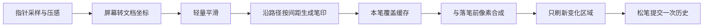

# PhotoSuite 画笔与交互研究及 Bowerbird 草稿编辑器建议

本文研究 PhotoSuite 当前官方后续项目 PhotoSplice 的画笔和交互实现，并与 Bowerbird「新建草稿」源码对照。结论是：新增独立草稿编辑器，复用 Bowerbird 已有图层、文字、视口和导出能力，补齐真正的画笔内核、按操作撤销及可重开的工程保存。先完成这些，再扩充选区和修图工具。

本文保留研究时的判断和分期建议。用户随后批准开发，2026-10-27 已实现草稿编辑器源码；实际范围、验证及原生验收边界见 [草稿编辑器](DRAFT-EDITOR.md)，产品决策仍以 PROJECT.md 为准。

## 研究对象与证据边界

- 旧官网 [photosuite.app](https://www.photosuite.app/) 实际重定向到 [photosplice.com](https://photosplice.com/)，并直接链接 [eolix/PhotoSplice 官方仓库](https://github.com/eolix/PhotoSplice)。因此后文以该官方现行源码为主要依据。
- 核验版本固定为 `0d23cb2010df4ad380613025f6dfcdcc431f67f7`，提交日期 2026-10-25，提交信息为 `chore: version bump to 0.9.25`。以下源码链接固定到此版本。
- 旧 `eolix/photosuite` 仓库读取返回 451，Git clone 返回 DMCA 403；[GitHub 公布的通知](https://github.com/github/dmca/blob/master/2026/10/2026-10-14-photopea.md)列有该仓库。这只说明旧地址的当前访问状态，不能据此认定项目停止维护，也不是对争议的法律裁定。
- 当前 [NOTICE](https://github.com/eolix/PhotoSplice/blob/0d23cb2010df4ad380613025f6dfcdcc431f67f7/NOTICE) 明确记载其基于 PhotoCraft `a96a621deea97d4b1ecd173b8b921587e33f3ca5` 修改。项目代码声明 MIT 或 Apache-2.0；随附笔刷、纹理、字体有各自许可。本建议使用自制圆形笔尖，不依赖这些资源包。
- 本轮完成源码与文档审查，没有运行 PhotoSplice 桌面版、构建其测试或测量真实数位板延迟；在线版交互检查未成功建立会话。文中性能收益是机制判断，不是本机跑分。
- Bowerbird 使用当前工作区源码；已有未提交改动未修改。索引所列 `dev-doc/Bowerbird开发计划.md` 在本机不存在，本轮依据 PROJECT.md、PROJECT-CANVAS-PLAN.md、LAYER-EDITING.md、FOLDER-MODE.md 及实际源码对照，未据此直接实施产品改造。

## 最值得借鉴的实现

### 画笔是一条采样与合成流水线

PhotoSplice 的输入是 `StrokePoint`，包含坐标、压力、倾斜、旋转和时间；`Stroke` 保存笔刷参数和采样序列。它把“输入点变笔印”放在 `dynamics.rs`，把“笔印变覆盖率与像素”放在 `render.rs`。这比在 UI 事件里不断拼折线更适合软笔刷和稳定绘制。[数据模型](https://github.com/eolix/PhotoSplice/blob/0d23cb2010df4ad380613025f6dfcdcc431f67f7/crates/paint/src/lib.rs#L46)

**1. 收全采样，按帧刷新。** 当前界面在按下时立刻开始笔触，不等待拖动阈值；每帧读取属于本次按下至松开区间的全部指针移动，整批更新 live stroke。快速移动时不能只保留一帧的最后位置，单击也应留下一个笔点。Bowerbird 可用 Pointer Events 收样本，把绘制与 React 状态更新分开。[输入实现](https://github.com/eolix/PhotoSplice/blob/0d23cb2010df4ad380613025f6dfcdcc431f67f7/crates/ui-egui/src/canvas.rs#L3603)

**2. 按行进距离补点。** `PathWalker` 用 `next_at` 保存跨输入事件的剩余间距，沿每段路径插值坐标与压力。启用固定 spacing 时，笔印间距与笔刷直径有关；不能每收到一次事件就盖一个圆，否则事件频率改变会影响密度。首版只需固定间距圆刷；喷枪、散布、纹理、双重笔刷都可后置。[路径采样](https://github.com/eolix/PhotoSplice/blob/0d23cb2010df4ad380613025f6dfcdcc431f67f7/crates/paint/src/dynamics.rs#L181)

**3. 平滑必须考虑时间和延迟。** `Smoother` 提供指数平滑和拉绳方式，带时间时按经过时间计算平滑强度，而非固定“每个事件平均一次”。Bowerbird 建议先做可关闭、默认较轻的指数平滑，并在收笔时明确补齐终点；高平滑会带来跟手延迟，不能只看线条更圆润。[平滑实现](https://github.com/eolix/PhotoSplice/blob/0d23cb2010df4ad380613025f6dfcdcc431f67f7/crates/paint/src/dynamics.rs#L49)

**4. 流量与不透明度需要分开。** Flow 决定笔印逐次累积的量；Opacity 限制整笔合成的强度。PhotoSplice 先积累本笔覆盖，再相对落笔前像素合成，避免把低不透明度圆点直接反复画到原图上形成不符合预期的深色接缝。橡皮复用同一笔印覆盖，改变目标 alpha；背景层还有专门的规则。[覆盖缓存](https://github.com/eolix/PhotoSplice/blob/0d23cb2010df4ad380613025f6dfcdcc431f67f7/crates/paint/src/render.rs#L429)、[笔触入口](https://github.com/eolix/PhotoSplice/blob/0d23cb2010df4ad380613025f6dfcdcc431f67f7/crates/engine/src/brush_cmds.rs#L408)

对 Bowerbird 最简单的普通圆刷，可把逻辑理解为：本笔覆盖 `c ← c + (1-c) × 笔印覆盖 × flow`，最终有效 alpha 为 `c × opacity`。这只是首版的简化设计，不是 PhotoSplice 全部动态、颜色和混合模式的完整公式。每次预览都从落笔前的对应像素重新合成，不能拿已经预览过的结果再次叠加。

硬度则控制笔尖覆盖分布。当前圆笔尖由实心核心和渐变肩部组成，最硬笔仍保留抗锯齿边缘；软笔实际影响范围可大于标称半径。源码分别计算笔尖衰减、实际影响范围和光标轮廓，因此计算 dirty rect 时不能只用光标圆的边界，否则会截断软边。Bowerbird 首版可使用自定义的硬圆/软圆曲线，先保证边缘连续、预览和输出一致。[笔尖实现](https://github.com/eolix/PhotoSplice/blob/0d23cb2010df4ad380613025f6dfcdcc431f67f7/crates/paint/src/lib.rs#L141)

**5. 变化区域比整图重画更重要。** 当前画笔覆盖缓存采用稀疏的 64×64 小块，维护 dirty 集合，增量合成受影响区域。这是画笔覆盖块，不应与架构文档中的文档存储块混为一谈。Bowerbird 首版可先用受影响矩形保存前后像素，但要设置总历史内存预算；压力测试证明需要时，再升级为分块补丁。[渲染实现](https://github.com/eolix/PhotoSplice/blob/0d23cb2010df4ad380613025f6dfcdcc431f67f7/crates/paint/src/render.rs#L590)

**6. 预览和最终提交共享结果。** `LiveStroke` 从落笔前文档生成实时像素；正常提交时核对文档版本、参数、随机种子及点序列，符合条件就接管这份像素，不再重算整条笔迹。一次按下至松开只应产生一条历史；取消则恢复落笔前状态。[LiveStroke 与提交匹配](https://github.com/eolix/PhotoSplice/blob/0d23cb2010df4ad380613025f6dfcdcc431f67f7/crates/engine/src/brush_cmds.rs#L416)、[松笔提交](https://github.com/eolix/PhotoSplice/blob/0d23cb2010df4ad380613025f6dfcdcc431f67f7/crates/ui-egui/src/canvas.rs#L5700)

### 交互依赖明确的手势所有权

| 要解决的问题 | PhotoSplice 的实现 | Bowerbird 建议 |
|---|---|---|
| 缩放后落笔不准 | `ViewXform` 集中转换文档、屏幕、缩放和 DPI | 所有绘画、命中和移动共用一套坐标变换；笔径以文档像素保存 |
| 空格拖动画面时突然画出线 | 临时工具覆盖与当前选择工具分离，手势按下后锁定至松开 | 空格或中键开始平移后，即使先松空格也继续完成平移；不交给底下的画笔 |
| 输入文字误切工具 | 菜单、弹窗、文字输入、变换拥有优先处理权 | 输入框、中文输入法组合输入时不响应 B/E/V/T；草稿内部快捷键不穿透到外部画板 |
| 撤销粒度错误 | 滑块拖动合并，结束后才提交历史 | 一笔、一次变换、一次连续文字编辑各一条记录；新修改清空 redo |
| 吸管时多画一笔 | Alt 临时吸管先拦截绘画事件 | 按 Alt 取色，松开恢复画笔；同一指针事件只有一个工具处理 |
| 调笔刷尺寸后撤销对象不对 | 参数手势合并命令日志，不占图像历史 | 调笔径、颜色、硬度不进入文档撤销；Cmd/Ctrl+Z 仍撤销上一笔 |
| 视图调整污染工程 | 视图状态与编辑状态分开 | 平移、缩放不更改图层坐标，不进入文档历史 |

源码依据：[坐标转换](https://github.com/eolix/PhotoSplice/blob/0d23cb2010df4ad380613025f6dfcdcc431f67f7/crates/ui-egui/src/canvas.rs#L876)、[临时工具](https://github.com/eolix/PhotoSplice/blob/0d23cb2010df4ad380613025f6dfcdcc431f67f7/crates/ui-egui/src/hold_keys.rs#L206)、[快捷键优先级](https://github.com/eolix/PhotoSplice/blob/0d23cb2010df4ad380613025f6dfcdcc431f67f7/crates/ui-egui/src/shortcuts.rs#L332)、[局部历史](https://github.com/eolix/PhotoSplice/blob/0d23cb2010df4ad380613025f6dfcdcc431f67f7/crates/ui-egui/src/edit_history.rs#L31)、[调笔刷](https://github.com/eolix/PhotoSplice/blob/0d23cb2010df4ad380613025f6dfcdcc431f67f7/crates/ui-egui/src/brush_resize.rs)。

首版不必复刻它的长按临时工具、全部修饰键组合、旋转视图、可定制快捷键、复杂画笔 HUD。先把按下、移动、松开、取消、失焦这五个阶段处理正确。

### 架构文档不能直接当成实现清单

PhotoSplice 当前使用 Rust、egui 与 wgpu。架构文档仍标 draft v1，并明确说明 `tools`、`viewport` 尚未拆成独立 crate；当前很多工具事件与坐标逻辑位于大型 `ui-egui/src/canvas.rs`。应借鉴职责与数据边界，不宜照搬文件组织。README 的完整功能宣称、菜单注册覆盖率和旧 ROADMAP 的 alpha 自评，也都不能替代功能或性能验收。[架构文档](https://github.com/eolix/PhotoSplice/blob/0d23cb2010df4ad380613025f6dfcdcc431f67f7/docs/architecture.md)

## Bowerbird 当前实现差距

| 当前能力 | 源码位置 | 对最简 PS 的影响 |
|---|---|---|
| 右键空白新建，冻结项目与落点；节点保存失败后重试复用已存资产 | `CanvasWorkspace.tsx:2307–2350` | 保留这一入口与异步归属契约 |
| 固定 1600×1200 白底，默认矩形工具 | `ImageAnnotator.tsx:97–105, 389–392` | 增加尺寸与透明背景，绘画入口默认画笔 |
| 矩形、箭头、椭圆、铅笔、文字、裁剪、90°旋转 | `ImageAnnotator.tsx:55–72, 1003–1040` | 几何与输出算法有复用价值 |
| 铅笔逐事件复制完整 points 数组，React 更新，SVG polyline 显示，Canvas lineTo 导出 | `ImageAnnotator.tsx:644–660, 839–841, 251–255` | 不是像素笔刷；长笔迹有重复分配与重建字符串的风险，尚未测量实际耗时 |
| 笔径按显示像素换算 | `ImageAnnotator.tsx:372, 638, 1058–1068` | 窗口大小会影响同一笔径对应的文档像素，应统一成文档像素 |
| contain 适应显示，无编辑器内放大和平移 | `ImageAnnotator.tsx:425–447` | 无法精修细节 |
| 只有撤销栈，没有 redo；Shift+Cmd/Ctrl+Z 也进入 undo 分支 | `ImageAnnotator.tsx:449–483` | 必须补齐成对历史与快捷键语义 |
| 橡皮图标对应清空全部标注 | `ImageAnnotator.tsx:697–700, 1080–1087` | 需要真正的局部 alpha 擦除 |
| 形状不接收指针，文字先输入再放置 | `ImageAnnotator.tsx:605–622, 1130–1181` | 画完不能选中移动、单独删除或修改已有文字 |
| 保存为烧录单图及标注信息；重开清空 shapes/ops/history | `ImageAnnotator.tsx:328–393, 703–745` | 不能继续编辑旧图层与文字，是最重要的闭环缺口 |

完整代码入口：[图片标注器](../apps/desktop/src/components/ImageAnnotator.tsx)、[画板入口](../apps/desktop/src/components/CanvasWorkspace.tsx)、[标注模型](../apps/desktop/src/lib/types.ts)。

当前 `AnnotationMeta` 是给模型使用的 0–999 坐标和语义 token，不能当绘图工程权威数据。工程内部应使用精确文档像素坐标；确实需要模型标注时，再在输出阶段转换。否则大图重开精度、笔迹重放和后续变换都会受到限制。

## 建议的最简 PS 范围

目标工作流是：**新建画布 → 放参考图 → 在独立图层画或擦 → 调整位置与文字 → 保存工程 → 输出到画板 → 再次打开继续修改。**

| 层次 | 建议范围 |
|---|---|
| 第一可用版必须有 | 自定义尺寸、白底/透明背景；导入或粘贴图片为图层；硬圆/软圆画笔；橡皮；取色；移动、等比缩放；可编辑文字；图层新增/删除/复制/排序/显隐/锁定/不透明度；undo/redo；工程保存与重开；输出 PNG 到原项目画板 |
| 完成核心后补齐 | 矩形像素选区、清除/填充、裁剪；矩形/椭圆/箭头；复用已有 PSD 导出 |
| 暂不纳入 | PSD 导入与完整往返、智能对象、滤镜库、曲线与色阶、修复/仿制、复杂蒙版、钢笔路径、CMYK/高位深、ABR 笔刷包、复杂混合模式 |

“矩形像素选区”与“选择一个图层”是不同能力。前者会影响画笔、擦除、填充和复制的像素范围，应在图层编辑稳定后单独实现，不用一个选中框假装完成。

界面建议采用左侧单列工具、顶部当前工具参数、中央画布、右侧图层。画笔只露出颜色、大小、硬度、不透明度、平滑；流量先固定或放进展开项。窗口较窄时允许收起图层区，但不能遮住当前画布操作。工具图标有名称、快捷键提示和明确选中态；精密桌面操作不机械套用移动端的大按钮布局。

建议快捷键：`B` 画笔、`E` 橡皮、`V` 移动、`T` 文字、`I` 吸管、`[`/`]` 调整笔径；空格临时平移，Alt 临时吸管；Cmd/Ctrl+Z 撤销、Cmd/Ctrl+Shift+Z 重做；Esc 先取消当前手势或结束文字编辑，不直接丢弃整个工程。

文字层和锁定层不能被画笔悄悄栅格化。最简单的规则是显示“新建绘画层”操作，创建后再画；避免一落笔就破坏可编辑文字。背景作为独立底层，绘画层擦除到透明后显露背景；透明画布可关闭背景层。

## 推荐实现路线

### 保留 Tauri 和 React，局部引入绘画核心

首版用 React 管工具栏与图层列表，Canvas 2D 管像素；SVG 或 DOM 只负责选中框、手柄、笔尖预览和文字编辑。指针高频数据放入 ref 或普通对象中的绘画会话，按 requestAnimationFrame 更新画面；React 只在参数变化和一次操作结束时同步必要状态。

不逐采样调用 Rust IPC，不逐帧传整张 PNG，不为这个功能把整套 egui/wgpu 应用嵌入 Bowerbird。Rust 继续负责可靠文件读写、工程指针和素材入库。若 2048 日常场景与 4096 压力场景证明 Canvas 2D 是瓶颈，再针对已测出的热点考虑 Worker、WASM 或 GPU，不先引入另一套编辑器运行时。

建议职责划分：

- `DraftEditor`：界面、工具路由、手势所有权、文字编辑与画板出口。
- `draftDocument`：画布尺寸、图层身份、位图/文字内容、几何和显隐，不混入缩放视口和选中状态。
- `brushEngine`：采样、平滑、间距、笔尖覆盖、本笔缓存及局部合成。
- `draftHistory`：一笔或一次操作的前后补丁、undo/redo、历史内存预算。
- 原生工程保存：复用现有不可变文件与指针交换方式，增加无来源素材的新建工程路径。

这些是建议边界，不要求一开始建立插件系统、通用命令注册平台或多种渲染后端。

### 可复用的 Bowerbird 能力及限制

| 可复用部分 | 复用方式与边界 |
|---|---|
| [useLayerViewport.ts](../apps/desktop/src/components/useLayerViewport.ts) | 已有锚点缩放、空格/中键平移、失焦清理；接入新的手势所有权，统一坐标转换 |
| [layerDocument.ts](../apps/desktop/src/lib/layerDocument.ts) | 复用图层几何、顺序、显隐、不透明度和文字排版；不要直接把原 schema 当无限扩展的草稿格式 |
| [LayerEditor.tsx](../apps/desktop/src/components/LayerEditor.tsx) | 抽取图层命中、移动/缩放和文字编辑，避免复制整个带云端拆分任务的面板 |
| [layerExport.ts](../apps/desktop/src/lib/layerExport.ts) | 复用已有 PSD 导出，验证新图层模型能正确适配；已有导出不代表支持 PSD 导入 |
| [layers.rs](../apps/desktop/src-tauri/src/commands/layers.rs) | 借鉴不可变文件、sync、数据库事务交换指针、失败保留旧工程 |
| `newDraftAt` | 保留项目身份、落点冻结和保存重试复用卡片的语义 |

现有 `LayerDocument` 原生校验固定 schemaVersion=1、最多 17 层、首层 background、每边不超过 6000 且不超过 3600 万像素；保存要求已有 asset_id。这些是已有 AI 分层工程契约，不应为了新草稿直接放宽或破坏。建议新增版本化草稿文档，显式适配可共享的图层和导出能力。

现有 `packLayerHistory` 去重的是整张 data URL，适合移动和文字属性快照。每笔绘画都会改变图片，即使去重仍可能保留大量整层 PNG。首版应改为当前操作影响区域的前后像素补丁，兼有步数和字节数限制；预算数值应由压测确定，不用“最多 30 步”代替内存控制。保存工程只需可靠保存当前可编辑状态，是否持久化撤销历史可单独决定。

### 输入和坐标的关键规则

1. 收到 pointerdown 后立即捕获指针，冻结本笔工具、目标图层和笔刷参数，立即绘制首点。
2. 使用 `getCoalescedEvents()` 时先做能力检测，返回空数组也回退当前事件；不要又处理整批样本又重复处理末尾事件。不能假定 WKWebView 与 WebView2 的支持相同。[MDN 合并采样](https://developer.mozilla.org/en-US/docs/Web/API/PointerEvent/getCoalescedEvents)
3. 鼠标使用固定压力；笔设备才按真实 pressure 驱动，并处理无压感设备。浏览器对不支持压力的按下设备可能返回 0.5，不能直接让鼠标笔径减半。[MDN 压力定义](https://developer.mozilla.org/en-US/docs/Web/API/PointerEvent/pressure)
4. 文档坐标、CSS 屏幕坐标、Canvas backing-store 像素分开。视口逆变换负责落点，devicePixelRatio 只进入显示缓冲尺寸；不能重复乘 DPR。
5. 采样点允许在画布外，栅格化时裁切。把轨迹每个点硬夹到边界容易沿边缘画出多余长线。
6. pointerup 先补处理末尾样本与收笔，再提交一次历史；pointercancel、失焦、窗口隐藏与丢失 capture 必须结束会话。首版可将意外中断视为取消本笔，恢复前态，防止留下无法结束的半个操作。[MDN 指针捕获](https://developer.mozilla.org/en-US/docs/Web/API/Element/setPointerCapture)
7. 平移、文字编辑和绘画不能同时拥有同一指针。工具栏切换或项目路由变化时先明确完成或取消当前手势。

### 工程保存必须与输出图片分开

工程是权威编辑数据，PNG 是投放到画板和模型的结果。重新打开工程不应把上次合成图再作为唯一底图，否则图层和文字仍不可编辑。

- 草稿拥有独立 document_id；素材身份、项目归属与画板节点分别记录。当前 `save_annotated_image` 会经普通入库路径合并相同内容；实现复核确认此路径是内容精确去重，注释中的 pHash 描述不准确。普通入库去重不能决定两个工程是否同一个身份。
- 保存固定当前工程版本与项目，完成文件落盘、工程指针和素材关联后才报告成功。工程保存成功而画板节点创建失败时，重试只补缺失步骤，避免重复工程和图片卡片。
- 已用于生成的参考图片保持当时像素，继续编辑草稿不能回写旧生成历史所引用的文件。更新草稿卡片时保留工程身份，生成用输出另作不可变快照。
- 关闭提供保存退出与放弃未保存修改；保存失败保留面板及编辑状态。新建但完全未编辑的草稿退出不制造空资产。
- 文件优先工作区现有随图资料不携带完整图层图片包。必须明确工程随项目迁移、复制、删除的归属，不能宣称复制 PNG 就搬走了整个草稿工程。[文件优先协议](FOLDER-MODE.md)

## 分阶段实施与验收

| 阶段 | 工作 | 通过条件 |
|---|---|---|
| D0 画笔原型 | 隔离画布完成硬/软圆刷、橡皮、轻平滑、采样、缩放平移 | 单击有点；快慢画不断线；同轨迹在不同事件分批下结果一致；预览与导出像素一致；不访问真实素材库 |
| D1 可编辑工程 | 接图层、导入图片、文字、文档坐标和 undo/redo | 擦除只影响当前层；文字能改；一次手势一条历史；缩放与调笔径不占历史；历史内存有上限 |
| D2 接回 Bowerbird | 新建草稿入口、工程保存重开、画板输出、失败恢复 | 重开保留图层和文字；失败不关闭；重试不重复建卡；切换项目不改变异步保存归属；旧标注入口仍正常 |
| D3 最简 PS 补齐 | 矩形选区、裁剪、基础形状、PSD 导出适配 | 所选区域外像素不变；裁剪与坐标一致；PSD 回读检查层序、alpha、文字；通过双端原生输入验收 |

专项检查应覆盖：

- 25%、100%、400% 显示时同一文档位置落笔一致，笔径数值不随窗口大小改变；高 DPI 不重复缩放。
- 50% 不透明度单笔交叉区遵守本笔上限，抬笔后第二笔可继续叠加；软橡皮正确露出下层。
- 空格按下、鼠标拖动、先松空格再松鼠标全过程不误画；Alt 取色不落笔。
- 按下后移出边界再回来、失焦、切工具、关闭、指针取消均无卡住状态。
- Cmd/Ctrl+Z、重做与中文输入法不冲突；文字焦点、弹窗和外层画板分别有正确快捷键范围。
- 以 2048 图像作为日常基线、4096 图像作为压力样本，记录输入到可见笔迹延迟、帧耗时分位数、松笔停顿、历史内存和保存耗时。目标先设为日常场景连续绘画接近 60fps，再用实际设备结果决定最大尺寸、笔径和图层数，不能以算法存在宣称已达标。
- Chromium 合成输入只证明逻辑；Windows WebView2、macOS WKWebView、鼠标与真实数位板分别验收，压感和倾斜尤其不能用模拟事件代替。

现成回归入口包括 `canvas-draft-ui.test.mjs`、`annotation-tools-ui.test.mjs`、`layer-viewport-ui.test.mjs`、`layer-text-ui.test.mjs`、`layer-history-ui.test.mjs`、`layer-project-export-ui.test.mjs`。本轮仅读取测试，不宣称这些测试已经重新运行。

## 实施取舍

优先级建议为：**连续画笔与视口手感 → 图层和撤销 → 保存重开 → 选区与修图扩展**。不过 D0 只是隔离原型，具备工程保存重开的 D2 才适合作为第一版交付。

不建议继续把所有能力追加进 `ImageAnnotator.tsx`。它的模型坐标、标注语义和烧录输出都有现有用途；独立草稿编辑器可以保留这些用途，同时使用更合适的像素、图层与历史模型。也不建议整包移植 PhotoSplice：当前目标用不到它的大部分色彩、文件格式和专业修图系统，替换 UI 运行时会显著扩大双端维护范围。
