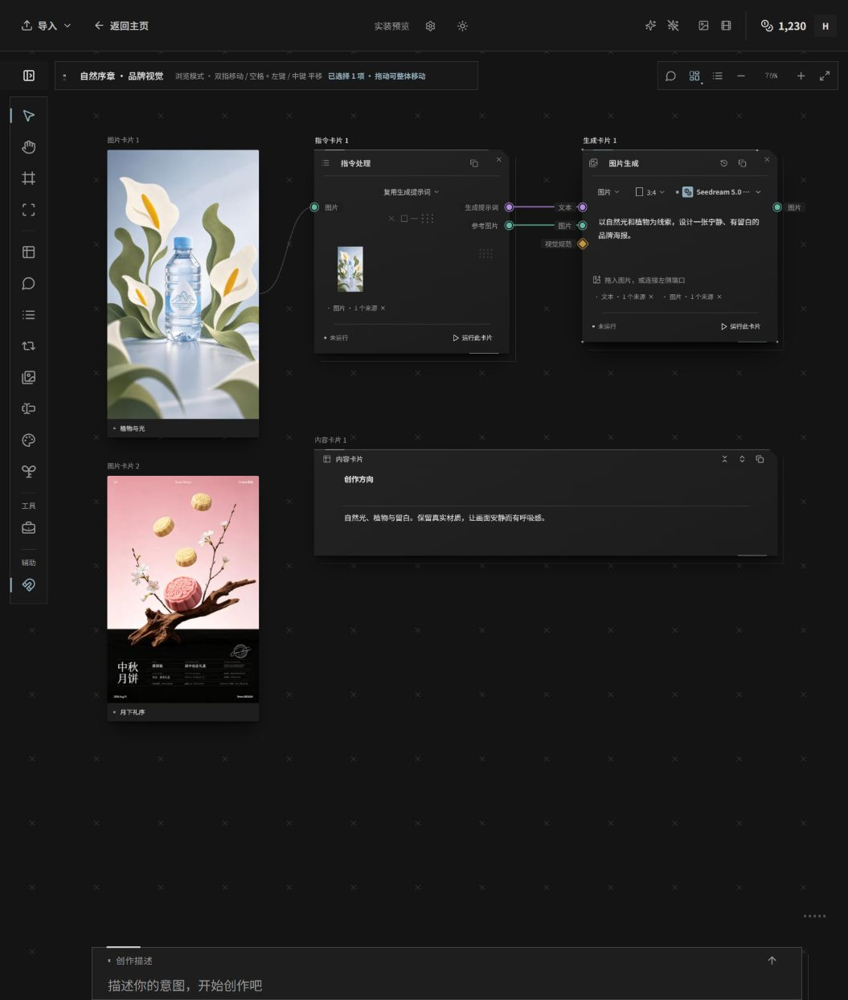
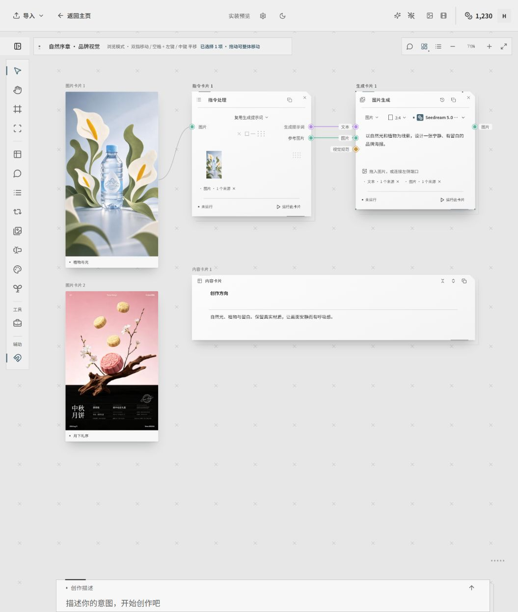

# Bowerbird 视觉与交互设计规范

版本：1.0 · 整理日期：2026-10-31 · 适用范围：桌面主应用

Bowerbird 的界面是一张供创作者持续工作的工业制图工作台：**石墨黑／中性浅灰底、清晰的阅读面、银灰细线、方点、稀疏小叉，以及有限的工程蓝状态提示。** 科技感来自结构、精确对齐与交互反馈；素材、文字和创作结果始终是视觉主体。

本文整理 [PROJECT.md](../PROJECT.md) 中已确认的视觉约定和当前正式源码，供设计、开发与验收共同使用。产品决策和实装状态仍以 PROJECT.md 为唯一权威；视觉决策变化先更新该文件，再同步本规范。这里的“正式”指主应用源码已接入，不表示已进入安装包。规范不改变现有业务布局和点击语义。

输入／输出的数据连接已按 2026-11-04 确认方案接入统一加号，见第 8 节；此前 `.tmp/` 的方框／方点端口仍是历史候选，不能视为正式规范。字号与间距建议见第 4 节，不代表本次已批量修改现有组件。

阅读索引：1–4 节定义视觉基础，5–9 节定义组件与交互，10–12 节用于实现与验收。下图是 2026-10-29 已确认 HUD 实装的合成资料验收图，用于对照深浅主题、卡片层次和媒体呈现，不代表全部业务界面的最新截图。

| 深色 | 浅色 |
|---|---|
|  |  |

## 1. 设计原则

1. **内容优先。** 先读到图片、文本和任务状态，再感知界面装饰。不得对原图增加滤色、扫描线、暗角或裁切来“统一风格”。
2. **用结构表达科技感。** 依靠开口线、端点、局部亮边和错位轮廓建立层次。减少整块灰底、完整实线框、嵌套托盘和装饰性文字。
3. **有选择地强调。** 工程蓝标识当前工具、选中项、创作状态与输入焦点。悬浮与键盘焦点保持工程蓝，移出恢复原色；业务来源色和错误／成功／警告色保留自己的意义。
4. **阅读面稳定，装饰层轻。** 卡片正文不透明；半透明用于边线、背景纹样和辅助状态层。HUD 悬浮感不以透出背后文字为代价。
5. **同一语言，不同职责。** 画布卡片、项目卡片、媒体和菜单使用相同色阶与几何语汇，但保留各自的布局和交互。
6. **反馈只发生在目标上。** 指针经过一个按钮，不得让相邻按钮、整条切换栏或另一张卡片一起闪动。

不采用：霓虹、强光晕、青灰色大底、毛玻璃作为唯一特征、全屏扫描噪声、三层大幅装饰平面、坐标条、无意义的英文代号。日常界面也不需要为了凑齐“科技元素”而加入圆弧或密集网格。

## 2. 色彩与材质

### 2.1 全局色板

以下是 [IndustrialTheme.css](../apps/desktop/src/components/IndustrialTheme.css) 的实际值。变量均带 `--industrial-` 前缀及 `-rgb` 后缀；表中十六进制只是便于阅读的等价值。

| 角色 | 变量中段 | 深色 | 浅色 | 用途 |
|---|---|---|---|---|
| 工作区底 | `canvas` | `#141414` | `#E7E7E7` | 画布、素材区底层 |
| 控制区底 | `chrome` | `#181818` | `#EFEFEF` | 顶栏、侧栏与工具区 |
| 阅读面 | `panel` | `#1E1E1E` | `#F7F7F7` | 菜单、对话框及通用面板 |
| 悬浮面 | `hover` | `#282828` | `#E1E1E1` | 需要独立表面的悬浮状态 |
| 基础线 | `line` | `#3D3D3D` | `#C5C5C5` | 结构分隔 |
| 装饰标记 | `mark` | `#747474` | `#707070` | 校准点、低层级标记 |
| 次要文字 | `muted` | `#949494` | `#646464` | 参数、辅助信息 |
| 次级正文 | `secondary` | `#B9B9B9` | `#4D4D4D` | 图标、次级操作、较强边线 |
| 正文 | `ink` | `#DCDCDC` | `#2B2B2B` | 标题、正文、主要图标 |
| 工程蓝 | `accent` | `#8FAAB8` | `#496775` | 当前状态和可操作焦点 |

新组件优先消费已映射的 `--bb-*` 公共变量；画布使用 `--cs-*`，素材库使用 `--lt-*`，项目面板使用 `--pm-*`。不要从早期 `styles.css` 的默认蓝色或旧预览复制一套局部色板。

### 2.2 重点色的分工

| 信息 | 表达方式 | 不采用 |
|---|---|---|
| 当前工具／持续选中 | 工程蓝文字、实心方点或短方条；适当加重字重 | 每项铺满蓝色背景 |
| 普通 hover／菜单键盘游标 | 工程蓝文字、轻微亮度变化、空心方点 | 冒充持续选中 |
| 主操作 | 工程蓝文字、600 字重和局部 3px 方点 | 大面积荧光蓝按钮 |
| 输入焦点 | 细工程蓝轮廓或当前输入线增强 | 靠短闪作为唯一焦点提示 |
| provider 来源 | 保留既有来源图标／来源色，同时标记当前选择 | 把不同来源统一染蓝 |
| 成功、警告、失败、危险操作 | 对应语义色 + 图标或明确文字 | 只有颜色，没有状态信息 |

成功／警告／危险色继续使用 `--bb-success`、`--bb-warning`、`--bb-danger`，不要将其重新解释为装饰色。任务失败、待审批、待澄清等状态的优先级高于普通 hover。表单错误聚焦后仍需保留错误指示。

### 2.3 透明度与深浅主题

- 画布文字卡片和通用菜单的阅读面不透明。HUD 卡片另用第 6 节的表面值。
- 普通轻悬浮叠加使用 `ink / 3.5%`；画布分隔线使用 `muted / 25%`，菜单边线使用 `muted / 30%`。低对比线不能承担唯一的操作或焦点提示。
- 当前工业主题把素材库 `--lt-screen` 映射为 `panel / 94%`。早期示意中的 77.6%／80.8% 不是当前全局目标，不应据此把全部面板重新透明化。
- 浅色模式靠中性灰底、纸白阅读面、深色细线和接触阴影建立层次。不得通过全页变白、降低所有线条透明度来生成浅色版。
- 深浅主题保留同样的结构、状态标记和装饰密度；透明图片的 alpha 与真实颜色保持原样。

## 3. 视觉元素与层次

| 元素 | 适用位置 | 规则 |
|---|---|---|
| 1px 细线 | 开放单元格、标题分隔、弹层边界 | 优先分段，两端留白；避免每个内部区域都闭合成框 |
| 2–4.8px 方点 | 选中提示、卡片端点、局部交互 | 方点中心与其所标记的几何位置对齐；素材库控件 2px、HUD 角点 3px、媒体悬浮顶点 4.8px |
| 空心小方框 | 悬浮游标或真实选择控件 | 必须与实心选中点可辨，不作为所有图标的替代 |
| 短方条／亮线 | 当前工具、局部顶沿、创作状态 | 只强调一个局部，不贯穿所有控件底部 |
| 稀疏小叉 | 画布和素材区域的底层纹样 | 低对比、鼠标穿透，不铺进正文和媒体上方 |
| 局部方点阵 | 菜单或辅助框的少量校准细节 | 限于留白区域，不是全屏高密度贴图 |
| 单层错位轮廓 | 菜单、弹窗、HUD 卡片后缘 | 一层即可，轮廓比正文弱 |
| 右上裁角 | 工作流／内容／本机对话卡片前景 | 遵守关闭按钮和端口边界，不能直接裁切整个节点 |

画布小叉以 **80×80px** 固定屏幕间距绘制；叉形约 6×6px，线宽 0.8px。深色使用 `#DDD / 16%`，浅色使用 `#222 / 17%`。素材库保留自己的 **96×88px** 稀疏叉阵，不强制改成与画布同尺寸。

层次按职责组织：工作区底色 → 背景纹样／环境装饰 → 内容与卡片 → 当前交互反馈 → 浮层菜单 → 模态面板。具体 z-index 复用组件体系，不另建全局“大数字”规则。装饰使用 `pointer-events: none`，不进入键盘焦点或无障碍名称。

顶部、侧栏和素材区的区分由控制分组、间隙、局部开口线和各自的底层形状共同完成，不只依赖三块不同颜色。左侧装饰为字母导航、目录树和滚动条留出使用区域；右下装饰属于背景，不能压住图片或缩略图大小控制条。顶部 hatchbar 不恢复。

## 4. 排版、图标与间距

全局字体沿用 `Inter, Noto Sans SC, PingFang SC, Microsoft YaHei, -apple-system, BlinkMacSystemFont, Segoe UI, sans-serif`，基础字号 14px。项目面板目前有自己的系统字体覆盖；不为统一风格另加一套展示字体。

下表是新增／修订组件的取值建议，已有专用组件按其几何契约保留尺寸：

| 用途 | 建议字号 | 字重与排版 |
|---|---|---|
| 面板主标题 | 22–26px | 500，通常一行 |
| 卡片标题／主要控件 | 13–14px | 500；选中可用 600 |
| 正文、提示词、编辑内容 | 14px | 400，行高约 1.5–1.7 |
| 参数、列表项、次级操作 | 12–13px | 400–500 |
| 辅助元数据 | 11–12px | 只放非关键内容，避免承载长句 |

不新增用于营造科技感的超小英文副标题。标题、正文、参数的区分优先依靠位置、字号和字重，不用重复标签；输入／输出正文上方不再放无功能的 `INPUT / PROMPT` 及其占位高度。必要的字段名、错误解释和图标无障碍名称必须保留。

图标使用项目现有线性 SVG 体系。同一位置的尺寸、笔画和光学重心一致；卡片按功能使用自己的图标，不全部变成方框。关闭 X 在按钮可点击区域内居中，不能根据裁角的可见面积随意偏移。图标按钮需有明确的 `aria-label`，必要时提供 tooltip。

间距优先取 4／8／12／16／24／32px；小方点和几何校准允许 1–3px 专用值。组件内部通过留白形成分组，尽量不再加灰底容器。现有顶部操作按钮 32px、账号整体 40px、工作流关闭按钮 35×34px 等是专用值，不应强行归入同一个尺寸。

装饰尺寸不等于点击尺寸。画布加号使用第 8 节的固定屏幕热区，旧精确连接保留定位；普通操作应有足够的点击留白。长名称允许截断并提供完整名称入口，长正文换行，不能为了保持视觉齐整而裁掉错误或任务状态。

## 5. 状态与交互

| 状态 | 可见反馈 | 行为约束 |
|---|---|---|
| 常态 | 中性正文、克制底面 | 无持续闪动，无常驻四角装饰泛滥 |
| 悬浮 | 局部亮度／细线变化；允许一次短闪 | 只作用于当前目标，不改变选中值 |
| 键盘焦点 | 持续可见的细轮廓；菜单内中性游标 | 可见且不被固定层遮挡；不能只出现一瞬 |
| 持续选中 | 实心点、字重／工程蓝或组件专用标记 | 鼠标离开后仍可辨；不依赖动画结束时机 |
| 按下／执行 | 明确的按下或任务反馈 | 不以装饰动画代替真实进度 |
| 禁用 | 降低视觉强度，保留名称与原因入口 | 不触发 hover 动画、执行或伪选中 |
| 加载／运行 | 现有进度、等待或执行状态 | 不能被主题覆盖清空；不伪造百分比 |
| 错误／危险 | 语义色与明确文字／图标 | 可操作的恢复入口保持可见 |

同一组件的 hover、focus、selected 和 error 可以同时存在，不能用普通 hover 规则覆盖选中或错误的稳定颜色。视觉反馈结束后必须回到实际状态；不允许通过动画最后一帧维护选中值。

“悬浮”“聚焦”“多选”“进入项目”是不同语义。右键打开菜单不能仅因菜单打开就触发多选装饰。双击、拖动、框选等继续遵循对应组件原有行为，不由换肤重新定义。

### 5.1 统一悬浮滚动条

2026-11-03 用户明确要求：应用管理的所有滚动区域共用悬浮滚动条，覆盖页面、侧栏、菜单、弹窗、编辑器和横向素材条；**不得占用内容宽度或高度，不得因显隐挤动内容**。透明原生轨道、`thin` 或 `scrollbar-gutter: auto` 不能单独视作满足这一要求。

视觉统一为透明轨道、直角滑块与密集单色斜条；使用同一组主题变量，深色亮灰、浅色深灰。按用户本轮反馈，滑块可见宽度为 4px（原候选 5px 缩窄 20%），斜条线厚 1px（原候选 2px 减半）、留白 2px，整体可见透明度 50%。**仅滚动期间浮现**，停止后淡出，悬停本身不触发显示、不增加亮度；拖动期间保持可见。保留原生滚轮、触控板、键盘、拖动和轨道定位，以及原滚动元素、虚拟列表映射和编辑器选区。隐藏轨道不得拦截点击或留下不可见的 Tab 焦点。

新增滚动区域须接入共用实现，不另加占槽的原生宽度或独立滑块样式。验收应启用浏览器原生滚动条，测量双轴内容尺寸并验证菜单、动态内容、缩放画布及隐藏页面；只用默认隐藏系统滚动条的无头浏览器截图不算通过。正式共用实现为 `src/components/OverlayScrollbars.tsx`，根入口和独立滚动包装器共享管理器；停止滚动 800ms 后以 120ms 淡出。接入状态见 [本次记录](../project_logs/2026-11-03-notification-scrollbars.md)。

### 5.2 素材拖出反馈

2026-11-03 用户确认的透明投影反馈由画布长按与素材库直接拖出共用：240ms 渐显整窗静态模糊，按源素材位置绘制轻量投影轮廓；无底板的操作提示、贴边方点／短线的系统缩略图。全息质感由局部亮边、前后层次与虚实关系表达，不铺满弧环或虚构数据。图片保留比例和原色、无容器留白，减少动态效果时显示终态。素材库拖动停留在应用内时暂时隐藏模糊与 HUD，集合名称和画板落点保持清晰，离开窗口再恢复；画布长按的外拖状态仍禁止同窗投递。系统拖影与原件载荷分离，源码／真机边界见 [素材拖出](EXTERNAL-DRAG.md)。

### 5.3 探索采集悬浮缩略图

采集中的图片完整等比显示，容器随图片实际尺寸收紧，在 96×112px 内呈现；不加内边距、白底、圆角托盘或裁角，不裁掉原内容和透明区域。媒体角落使用贴边 4.8px 方点和克制投影；候选标签与状态沿工业中性色、小方角及工程蓝，不保留绿色胶囊或圆形手势徽章。网页与主工作区共用同一绘制实现；未知尺寸时不显示空壳，图片更新后同步边缘与落点。减少动态效果直接显示终态。展示预览须独立于分类模型的补边输入，详见 [采集缩略图记录](../project_logs/2026-11-04-explorer-drag-visual.md)。

## 6. 画布卡片

### 6.1 外形与悬浮感

工作流、内容和本机对话卡片使用不透明前景与右上裁角；方点和分段细线按卡片结构定位。卡片与画布之间有接触阴影和较远的投影，工作流／内容卡片后方再保留一层错位开口线。**画布节点自身不因 hover 平移、缩放或倾斜**，端口和连线坐标保持稳定。

下表的后缘与标题细节针对工作流／内容卡片；本机对话复用裁角前景与投影。其他卡片保留自己的轮廓，只接入适用的离板阴影。

| 参数 | 当前值／实现 |
|---|---|
| 右上裁角 | 14px，仅裁前景层 |
| 深色前景渐变 | `#232323 → #1C1C1C`，155° |
| 浅色前景渐变 | `#FCFCFC → #F4F4F4`，155° |
| 后缘 | 向右 10px、向下 13px；只画右边与底边 |
| 顶部短亮条 | 左起 18px，32×1px |
| 底部短线 | 48×1px，靠右并留 18px |
| 角点 | 3×3px；关闭按钮附近的方点按按钮定位 |
| hover／选中层次 | 增强阴影和局部边缘；工作流／内容壳与本机对话的阴影过渡 160ms |

正式阴影变量来自 [IndustrialCanvas.css](../apps/desktop/src/components/IndustrialCanvas.css)，不要用通用卡片阴影替换：

| 主题 | 常态 `--hud-shadow` | 交互 `--hud-shadow-active` |
|---|---|---|
| 深色 | `0 4px 6px -3px rgb(0 0 0 / .70), 0 20px 32px -11px rgb(0 0 0 / .62)` | `0 5px 8px -3px rgb(0 0 0 / .75), 0 25px 40px -10px rgb(0 0 0 / .76)` |
| 浅色 | `0 3px 5px -3px rgb(33 39 43 / .23), 0 18px 28px -10px rgb(33 39 43 / .26)` | `0 4px 7px -3px rgb(33 39 43 / .26), 0 23px 34px -10px rgb(33 39 43 / .32)` |

### 6.2 标题与关闭按钮

- 工作流标题保留语义图标和真实名称。模型、比例等参数整合在卡片内部，不单独悬浮在上方。
- 关闭按钮贴紧右上边缘，宽 35px、高 34px；X 在按钮中居中。方点位于该按钮左上角。
- 顶部短亮条保持左侧原位。贯穿顶沿的细线在关闭按钮左上角处结束，不伸到按钮后面或超出右缘。
- 裁角、阴影和装饰不能裁掉关闭按钮、端口、运行状态或连线命中区。不得在节点根元素直接添加用于外形的 `clip-path`。

### 6.3 各类卡片的差异

| 卡片 | 共性 | 必须保留的差异 |
|---|---|---|
| 指令／工作流生成／技能卡（`.workflow-card`） | 裁角、细线、真实图标、同一状态层级 | 原有参数、provider、运行／审批／失败状态 |
| 触发器 | 沿用主题材质、运行状态与控制端口 | 宽 196 的紧凑控制门，以继电器触点表达信号放行；模式菜单选择手动点击／每天定时／一次定时／上游完成。手动操作置右下角，定时显示 24px 等宽 `HH:mm`，完成模式显示剩余次数。标题栏高 28，无端口空白区或重复终态页脚；端口标签向外，左右锚点距顶 46 |
| 内容卡片 | 与工作流同一外形和悬浮层次 | 单元格使用两端留白的开放细线，不铺灰块，不围闭合网格 |
| 气泡／便签 | 中性阅读面与离板阴影 | 尖角与正文面同色；文本不继承旧黄色或装饰字样 |
| 图片／视频／素材组 | 离板层次和对应交互反馈 | 保留真实像素、比例与透明通道，不增加遮色前景 |
| 独立 Agent／生成会话 | 同一字体、状态色和离板层次 | 保留原轮廓、状态边框、交付结果与历史，不强制套工作流裁角 |
| 本机对话 | 裁角前景、同一阅读面与投影 | 保留对话与执行反馈，不额外套工作流的后缘轮廓 |
| 分区／画板框 | 同一线色和标记语汇 | 保持平面，不与内容卡片一起抬高 |

创作模式激活时，输入区用分段细线、短条、方点和辅助轮廓显示工作状态；画板内框用有限的警戒斜纹和边缘条提示模式。退出后清理状态层。不得恢复虚线外框，也不把整幅画布染成重点色。

## 7. 素材库、项目页与媒体

### 7.1 素材库

沿用现有顶部切换条、侧栏、浮动标题、瀑布流和缩略图大小控制器，不因换肤改变布局。集合模式使用真实目录树与连续分组浏览；当前集合悬浮块随滚动更新，侧栏点击定位分组。标签模式保留自己的导航。具体行为以 [FOLDER-MODE.md](FOLDER-MODE.md) 为准。

集合侧栏的标题和行内加号为 12px，仅对应区域 hover／键盘聚焦时出现，保留原按钮命中范围。行内加号和更多只在 hover／键盘聚焦／菜单打开时为名称预留操作宽度，空闲时名称使用完整可用空间。右侧空集合收为 40px 单行标题与数量，扫描提示同行显示，不另设空态说明区；末组仍可定位到视口顶部。

画板顶部左侧使用「素材库」按钮打开现有素材栏，展开后在其旁边显示「建立连接」；再次点击可收起。首页与探索页沿用各自连接入口，不新增页面或独立素材数据源。没有连接文件夹也可单独拖入素材，文件保存与断开连接后的可见性遵循 [文件契约](FOLDER-MODE.md)。

控件直角、常态克制，不加统一细底线或左上定位角。普通状态去掉边角点，高亮状态只保留右下角点。首页顶部栏的「素材库／项目」切换条相对整窗居中，两侧操作和账号不会推动它偏移；使用图标、文字与透明底面，当前页以工程蓝文字与右下方点标识，不加重复目录标题。标签管理融入同组控件。账号与积分是同一个可进入账号面板的区域。

2026-11-02 确认并接入源码：共用顶栏高 44px，主按钮命中高度 32px；按钮、筛选组、账号区域均无常态／hover 背景色块和闭合边框。中性控制区底面通过断续的 1px 底线和组间短分隔线形成层次，局部 20×8px 方点阵跟随左侧操作组，窄窗隐藏，避免覆盖导航。hover／键盘聚焦仅当前目标进行 160ms 透明度短闪，结束保持工程蓝；持续选中保持工程蓝与右下 3px 方点，减少动态效果时取消闪烁。画布项目名和缩放区高 32px，透明底面、无外框，保留原位置和操作。实施记录见 [紧凑顶栏](../project_logs/2026-11-02-topbar-instrument.md)。

顶栏 Bcoin 左侧预留 36px 更新位，检测到新版才显示 18px 向上箭头圆环；沿用工程蓝，不常驻文案、不持续闪烁。按钮可通过键盘操作，悬停提示版本与更新状态，关闭更新设置后恢复焦点；预留位避免检测结果引发布局位移。

图片／视频类型切换使用语义图标；视频卡使用右下蓝色斜三角与播放符号识别，名称必须体现视频。标记不遮挡关键操作，不能只靠名称猜测媒体类型。

2026-11-01 视频增量：卡片以角落时长和既有播放符号表达类型；停留 500 ms 后静音预览，移开即停止，整库只有一个悬停解码器。多选及减少动态效果时保持静态。播放器统一音量、倍速、全屏、定位与截帧；竖屏原画及胶片都保持比例，采集进度只显示真实信息，不增加装饰性副标题。具体行为与验收见 [视频媒体](VIDEO-MEDIA.md)。

### 7.2 媒体 hover 与多选

**「对角定位」是素材 hover 的唯一共用动效。** 素材库、画布独立素材、素材组缩略图与生成会话图片复用 `MediaHoverMark`，只允许宿主适配命中与坐标，不复制时序、方点或射线实现。以后同类对象的同一行为必须共用同一动效入口，新增界面不得另做一套；选择、拖动、运行等不同语义仍保持各自反馈。画布缩放只改变素材大小，方点保持约 4.8 屏幕像素；减少动态效果时射线与闪烁都跳过，直接显示方点。

媒体 hover 使用左下与右上两个 **4.8px 方点**，中心对齐实际显示图片的对应顶点，不能按包含留白的外容器定位。

2026-11-01 确认并接入源码：中心向这组对角发射 1px 中性细线，缓入缓出，240ms 到达角点；270ms 起尾端向角点擦除，方点同时进行两次短促明灭，420ms 后稳定停留。终态只有两个方点，不带短边或箭头；替换四角顺时针移动。仅当前未选中的媒体触发，移出清理，减少动态效果直接显示终态；保留素材库原有轻抬反馈，不套到带端口的画布根节点。共用实现为 `MediaHoverMark.tsx`／`.css`，不代表已进入安装包。

多选使用 [LibrarySelectionMark](../apps/desktop/src/components/LibrarySelectionMark.css) 的专用反馈：预览缩至 88%，占位和间隔保持；外侧括号、中心方框和内侧线段约 300ms 到达终态。只在新选中时播放，虚拟列表重新挂载已选项不重播。多选不与 hover 四点动画混为一个状态。

### 7.3 项目管理

项目管理与素材库是首页的平级完整页面，占满顶部栏下方主内容区；无模态遮罩、关闭按钮或通用对话框外壳。随窗口增大自然增加卡片列数，窄窗口收紧边距。搜索、排序与新建放在内容区顶部，展示方式位于左侧，尺寸控制位于底部；项目封面左右各留 12px，不撑满卡片整个宽度。

通过顶部切换保留两页浏览状态与滚动，进入项目画布后返回仍回到原首页页签；隐藏页面不响应键盘和浮层请求，暂停视频与背景装饰。不新增 Tab 切页，素材库内部 Tab 行为保持。正式入口验证见 [首页导航记录](../project_logs/2026-11-02-home-navigation.md)。

项目卡片采用聚焦和 3D 悬浮层次来表达 hover／选中，不用左侧蓝 border。**单击项目进入项目**；右上箭头是装饰，不形成一个行为不同的假入口。标题右侧三点按钮打开与右键一致的菜单，点击菜单按钮不穿透进入项目。网格和列表模式各自保留合适的呈现。

项目卡片的 3D 效果属于项目导航反馈，不是所有画布节点的通用动效。不能为全库每张卡片长期建立透视动画或永久 GPU 合成层。

### 7.4 素材库创作入口

2026-11-04 最新确认稿替代同日早先光学框体：共用生成框采用无框全息投影。左侧项目／模式标签按对话演示稿使用白色渐隐底光、四角白方点、3.312px 间距与整组 HUD 倾斜，参数模型在前，发送按钮使用向右渐隐的轻底光，选中模式用左亮线与右方点，不靠颜色独自表达。11 月 5 日按反馈重新设计为局部投影：上弧线穿过项目标签中部、仅围合对话区并在两端渐隐，无下弧线或发光源。上缘羽化中线贴合细线，取消 22px 内缩空隙，配合椭圆径向衰减取代封闭曲面；细线上方仅有轻微羽化、两侧不留竖直边界。后景模糊仍为 14.4px，遮色从 32%–88% 降至 12%–68%；遮色／呼吸方点共用同一遮罩。左轨靠近正文 36px，窄窗口内移 24px，标签自身使用 6px 轻磨砂和白色渐隐底光保证可读；三组小叉矩阵分层视差和错时轻闪，文字与按钮不移动。正文默认单行，换行自然增长，输入区与发送按钮共用右侧对齐基准；4×20px 窄块光标跟随实际选区与 IME，选中文字和失焦时隐藏，空占位在激活时消失。底栏距底部 12px，700px 及以下为 8px；模糊与点阵高度按不含入场位移的布局计算，覆盖至应用底边，激活后不留露底缝。不设导入素材按钮，暂时移除独立参考图展示条；图片只在正文里呈现，保留原编辑器引用、预览与删除交互，不另占高度。「双击添加素材」置于弧线中央下方，使用 10px／16px 字号行高、0.06em 字距与 78% 不透明度，两侧短线方点缩短减淡，所有模式和深浅色均可见。收起态为 54px 单行，项目投影标签、草稿和展开按钮水平对齐，使用同一静态弧面，去除矩形底板与动态点阵。维持项目／品牌／模型菜单、收起草稿与原发送链路。切换三种模式直接呈现目标状态并恢复独立草稿，不重播整框淡入／上浮；投影在首帧前准备好，入场动画仅用于真正收起后的展开。收起、关闭、后台或不可见时停刷；减少动态时取消呼吸、闪动与视差，高对比静态保留选中态。源码位于 `IndustrialCanvas.css`、`creation/ComposerProjection.tsx` 和 `creation/useTerminalCaret.ts`；增强浅色演示待反馈，实装与验证见 [记录](../project_logs/2026-11-04-composer-projection.md)。

2026-11-03 确认主屏底部复用画板创作框；11 月 4 日按光学 HUD 确认稿将项目入口移至左侧模式标签最上方。项目菜单使用单层紧凑列表，名称省略与键盘操作沿用共用选择器。近期任务通过 Bcoin 左侧铃铛按需展开，完成通知可点击进入对应画板；不增加常驻说明文字。素材列表底部按创作框实际高度留出可滚动空间，多选时避让原操作条。交互状态与验证边界见 [PROJECT](../PROJECT.md) 和 [隔离预览](../apps/desktop/scripts/fixtures/library-composer/README.md)。

同日后续调整已获用户确认并实装：Bcoin 左侧铃铛收到完成消息后仅展开该条，无操作 4 秒收起；阅读或手动展开时保持面板。主屏素材库右下角尺寸栏隐藏，保留原尺寸状态，替代入口尚未确定。不能用常驻尺寸控件挤占生成框位置。实现与验证见 [通知与滚动条记录](../project_logs/2026-11-03-notification-scrollbars.md)。

主屏与画板的创作模式使用同一个状态标记组件和图片手势实现：工业细线、有限斜纹与顶部标签保持一致，单击图片显示第 9 节的图片／会话预览，双击仅添加一次引用。「素材」按钮与编辑框 Tab 聚焦当前素材栏，保留草稿；主屏仅额外提供项目选择，不另造旧式蓝框、圆角刘海或单击引用规则。普通浏览、修饰键多选及拖动沿用原操作。修改前画板深浅色样式已冻结为回归基线，见 [统一记录](../project_logs/2026-11-03-library-creation-parity.md)。

## 8. 输入输出端口

2026-11-04 确认并接入源码：数据卡片每侧最多一个 `＋`，左侧添加上游、右侧添加下游，不再常驻「文本／图片」端口标签。来源内容与目标输入的交集由连接层决定，用户可把连线放到整张卡片；同一次连接包含多种内容时只显示一条线。触发器的控制端口保留原信号语义，旧精确连接保留原落点。此项尚未进入安装包。

- 2026-11-05 最终修订：未选中且鼠标远离时隐藏加号，热区仍接收鼠标；直接悬浮热区即可浮现，无须先经过卡片。悬浮卡片、选中或键盘聚焦时也显示，离开且未选中时隐藏，禁用时关闭命中。牵线／连接菜单期间保留发起侧加号，不使全画布端口常亮。
- 共用 `CanvasConnectionHandle.tsx`／`.css`：按确认稿使用 28px 紧凑方框、四角 2px 方点及两侧短线；中心 18px 加号轮廓以 45° 细斜纹填充（2px 图案周期、0.5px 线宽），对应最终降低 50% 密度的版本，不画成整块斜纹方形。透明底，默认正文色 `--bb-ink`；外围细框为 0.6px／35% 透明度，保留清晰方点与侧线。热区宽高由 64px 扩大 20% 至 76.8×76.8px，随画布缩放反向补偿，均以屏幕像素计。标记中心仍在卡片边缘外 18px；热区朝卡片内的 20.4px 裁掉，避免覆盖正文、媒体操作和缩放把手。重叠热区按距中心最近者接收真实指针事件。
- 只有可见标记向鼠标偏移，最大 8px，向卡片内最多 4px，保证紧凑外框不被裁切；热区、卡片和连线锚点固定，离开后 160ms 回位。按下、拖线或连接菜单打开时停止磁吸；减少动态效果时关闭位移和过渡。普通状态中性，hover／焦点／活动使用已有工程蓝状态色，不增加整卡位移、类型色块或持续闪烁。
- 单击加号即可牵线，松开鼠标后线条继续跟随，再点目标完成；也可直接按住拖放。右键取消草稿且不打开画布菜单，Esc 同样取消。点击或拖放到空白才打开新建／连接菜单，菜单项共用单列满宽行，最小行高 32px，按窗口边界避让。键盘 Tab 可聚焦，Enter／Space 直接打开菜单。5px 仅区分首次点击与按住拖动；不兼容卡片显示就近原因，离开即清理，草稿不得当作已保存连线。无障碍名使用「添加上游／添加下游」。
- 原生内容格的旧类型点隐藏并退出命中／Tab 顺序，DOM 几何保留供历史连线定位；精确输出与行／列／单元格接收通过加号菜单的「指定内容／指定接收位置」选择。未选中且非草拟状态的连线继续使用中性 `--bb-line-strong`。早期 [方框／方点端口示意](../apps/desktop/.tmp/canvas-hud-ports/README.md) 不作为现行实现依据。

验收包括 10–250% 缩放、拖卡、内容格滚动后的固定锚点，热区重叠就近命中，正文编辑与缩放互不抢占，键盘开始／取消、减少动态效果、整卡接收、空白菜单、保存／撤销及旧连线兼容。入口与数据契约见 [画板工作流](CANVAS-WORKFLOW.md#2026-11-04统一加号与自动内容连接源码未发布)。

## 9. 按钮、表单、菜单与对话框

### 9.1 按钮与表单

普通按钮优先透明底或弱中性底，用文字、间距和局部反馈建立可操作性。主要操作采用第 2 节的工程蓝文字和方点；危险操作使用危险语义。不要在普通按钮上重复加完整框、底线、左上角和右下方点。

表单字段要能看出可编辑范围，但不把每个标签、参数组、字段外壳重复套进灰色托盘。保留真正有用的字段标签。聚焦输入时细线增强；错误提示邻近字段，遵循 [用户可见错误规范](USER-FACING-ERRORS.md)。

### 9.2 下拉与右键菜单

集合视图的「删除」子菜单中，分身提供「移出该集合」「删除原文件」，原件只提供「删除原文件」。前者只作用于所选分身，后者使用危险操作样式并进入共用确认框，显示真实原文件名、路径、系统回收站及其他引用受影响说明。全部／标签／集合／画布共用同一原件回收流程；批量混选不提供仅适用于分身的移出操作。项目移出、画布移出与文件夹断开保持独立。

普通选择入口复用 [TacticalSelect.tsx](../apps/desktop/src/components/TacticalSelect.tsx)，菜单视觉由 [IndustrialMenus.css](../apps/desktop/src/components/IndustrialMenus.css) 最终覆盖。卡片内部、对话框、工具箱、比例与模型菜单使用同一体系。

当前菜单是**不透明中性面、直角、1px 细边和向右下错位 8px 的单层轮廓**，顶部 35px 短线、底部 25px 短线及少量局部方点阵。工业主题已经把外层 `clip-path` 设为 `none`，不要将早期菜单的对角裁口误写为当前正式外形。允许菜单使用完整细边，不等于允许所有内部选项再套框。

选项 hover／键盘游标：工程蓝文字与空心 4px 方点与极淡悬浮面。持续选中：工程蓝实心 4px 方点、工程蓝文字和 600 字重，底面透明。来源图标、禁用组、危险项不被普通选项覆盖。

菜单挂在 `body` 的浮层体系，避免随画布缩放或被卡片裁剪；靠近窗口边缘时调整展开位置，长菜单内部滚动。支持方向键、首尾跳转、输入定位、Enter 选择、Escape 先关闭当前菜单、Tab 离开，并继承真实禁用状态。不能为了美观削减这些交互。

素材库支持直接拖出原件；画布素材原地长按 600ms 后继续按住拖出、松手投放，Esc 取消。按下后移动达到 4px 即进入普通画布移动，不因途中停顿触发拖出。达到长按阈值时，全窗使用静态 6px 模糊，系统携带图标保持清晰；结束、取消或失败恢复，不增加常驻说明或工具栏。混选仅携带已登记素材，组内缩略图只携带当前项，生成会话只取当前展示图片。移除旧右键抓起入口，长按投回 Bowerbird 取消且不新增或移动素材。原生与跨端验收边界见 [素材拖出](EXTERNAL-DRAG.md)。

### 9.3 对话框、设置与管理面板

对话框使用直角不透明阅读面、1px 细边、8px 单层错位轮廓；标题区用局部短线建立层级。关闭按钮居中可辨。内容通过分组留白、标题和开放分隔线组织，减少重复灰底框和无必要的英文副标。

设置、工具箱、分类管理和账号面板沿用同一色彩及状态语义，不能只“把旧界面染灰”。不同面板可以保留自己的信息结构，但按钮、选中项、字段与菜单应同源。模态打开后焦点留在当前任务范围，关闭后回到原触发入口；嵌套下拉先处理自己的 Escape。

### 创作图片与会话预览（2026-11-03 确认）

普通浏览与创作模式单击图片均显示悬浮原图与详情／会话阅读面；创作模式另支持已有图片产物的会话整卡入口，双击图片添加引用。各区域之间保留间隔和独立阴影，外围开口投影线建立整体空间，不增加共用实色底板。原图保留对角短标记，会话保留裁角面、局部顶边短线和一层错位后缘；可单独收起会话，原图位置保持。两侧材质按下方 11 月 4 日确认的半透明例外执行。

此局部采用克制的全息 HUD／电影式景深：背景使用静态渐变遮罩，正文与媒体清晰；不使用环绕刻度、准星或连续扫描。浅色环境为中性灰、阅读面为纸白，图片与会话使用同方向右下柔影，弱化白色漫光及后缘线。图片以 220ms 先展开，面板在数据就绪后沿项目卡片的节奏以一次 340ms 阶跃短闪显现，预览／会话以 140／120ms 退出；减少动态效果时直接呈现终态。正式组件与示意页同源，前序接入见 [行动记录](../project_logs/2026-11-03-creation-image-preview.md)，最新契约以 PROJECT 为准。

2026-11-04 后续：左侧复用图片详情，右侧会话仅在有历史或读取失败时显现；普通导入图片也单击打开。图片可越过初始适应范围缩放、平移，角标跟随图像边缘并维持屏幕尺寸；只在窗口边界裁切，独立面板与标题／控制位于图片上层。拖拽及光标锚定缩放仅从图片区域开始，空白单击退出，图片移出视野后仍可点「适应画面」复位；X／Esc 保留。空白拖动不平移图片，拖图后在外侧松手不误关；详情内交互不冒泡关闭。减少动态效果时停止指针跟随和装饰动效，功能性缩放仍可用。

同日用户明确要求两侧为半透明全息 HUD：这是当前预览相对全局不透明阅读面的局部例外。背景底面深色 48%–62%、浅色 50%–64%，以 12px 后景柔化、主题明暗校正及局部反光保证图片透出和正文可读；详情吸顶栏同步透底，文字、图标、缩略图保持实色。只处理背景装饰，不对整个面板设置 opacity；后景采样不被父级 filter 或入场动画残留合成层阻断。减少透明度／强制颜色时回退实色。

整体交互最新修订：保留外围定位线最多 4px 的装饰视差，移除前序鼠标光场、面板局部高光及亮边追踪。参考项目管理卡片与新建项目图示：图片后方保留两层薄片；两侧面板共用预览中央的旋转轴与透视中心，视为同一虚拟平面的两部分，鼠标向左则左侧整体后沉／右侧整体前抬，向右则相反，禁止各自绕面板中心旋转。跟随用同一 280ms 曲线，短线／方点和按钮采用相同阶跃短闪节奏；不复制项目组件业务逻辑。底板、标题、正文和按钮一起移动，鼠标按下选取、输入及键盘聚焦任一侧时，两侧一起锁定当前姿态，操作结束共同恢复；原图不随装饰倾斜。详情与会话标题均可收起，图片工具栏保留两个独立开关，收起详情保留编辑与滚动状态，并将焦点交回开关。四角的标题、关闭、尺寸及缩放控制按真实图片边界跟随缩放／平移，屏幕字号与尺寸不变；超出视野或与侧面板相遇时停靠到安全可见范围，空间不足时底部两组换行，回到视野后恢复贴图。控件沿用半透明投影材质，装饰不拦截空白点击。图片先呈现，面板请求在首个绘制帧之后并行；可见图片与入场就绪后，各侧真实数据读完再显现。等待／已收起面板不可命中或聚焦，无生成历史不显示空会话；几何位置预先保留，资料迟到、任一侧收起都不推动图片。减少动态效果关闭跟随和短闪，功能性标签定位仍跟随图片，故障仍可关闭或查看已有详情。

会话续轮：右侧底部固定简洁输入区，Enter 换行，按钮或 Ctrl／⌘ + Enter 发送；沿用原会话模型及比例，新轮、图片和失败提示就地更新并滚到最新内容。输入区与整侧一起参与共同姿态和输入锁定，收起面板保留草稿与阅读位置。生成中显示定向停止入口，恢复中防重复发送；无可接续会话或权益不满足时显示现有中文原因。发送不切换主创作框、当前项目或原图位置，关闭后不提交尚未完成恢复的请求。

2026-11-05 精简：左侧直接显示信息，取消「信息／再创作」切换与再创作内容，生成来源和续轮由右侧承接。玻璃后景滤镜只用于两侧阅读面；全屏遮罩、点阵、四角控件和详情吸顶栏不再叠加滤镜。保留透明渐变、层叠边线及共同透视，不通过关闭全局硬件加速改变其他界面。

### 截图与钉图补充（2026-11-01）

图片标注与截图的公共标注核心已统一：色板、箭头、文字编辑／排版、绘制与撤销共用；截图保留捕获和选区外壳。命中已有描边滚轮调整 1–32px，连续滚动一次撤销；截图空白处调下一笔，文字编辑／绘制中和 Ctrl+滚轮不修改对象。实心状态仅影响矩形／椭圆。键盘与鼠标输出均包含当前编辑文字，过程与隔离回归见 [审查修复](../project_logs/2026-11-01-review-fixes.md)。

独立钉图保留真实图片比例，无常驻工具栏与实线外框；使用原生悬浮阴影，右上／左下各一个 4.8px 方点，方点不拦截鼠标且不进入复制／导出像素。双击／Esc 关闭，超过拖动阈值才进入窗口移动。截图标注采用紧凑工具栏与画面内文字输入；历史复用 `ModalShell`，按缩略图、时间和尺寸呈现，查看原图后可用方向键或逗号／句号浏览。设置中的自动入库默认勾选。实现与验证见 [记录](../project_logs/2026-11-01-screenshot-history.md)。

### 9.4 探索浮动把手（2026-11-04）

探索专用控件为 14.4×76px，位于面板右边缘内侧中央；左侧上下各切去 4px，右边缘贴合面板。上方 28px 关闭区使用单一 X，下方为拖动握柄，以局部短线分组，不放 ESC 小字。底色沿用面板，悬停／聚焦时描边使用工程蓝，键盘焦点仍有清晰内框。网页保持完整宽度，原生裁剪与控件外轮廓相同，不使用扩大矩形露出背景。素材库默认页签保持原样。实现、深浅近景及原生验证见 [记录](../project_logs/2026-11-04-explore-handle-redesign.md)。

## 10. 动效

动效表达接触、定位和状态切换。局部可以有接触不良式的短促明灭，但不让正文、整张图片或整个面板持续闪烁。单次效果完成后稳定停留，减少动态效果时直接呈现清晰终态。

| 场景 | 当前时长 | 范围与终态 |
|---|---|---|
| 公共控件／菜单接触短闪 | 160ms | 局部标记或叠加层；结束回到真实状态色 |
| 共用生成框展开／收起 | 320／140ms | 展开从下方 12px 回位，后层 400ms 收束，边沿光线 560ms 单次显现；收起 4px 回位，正文不加模糊，完成静止；减少动态效果直接终态 |
| 生成框 HUD 标签选中 | 160ms | 仅下沿细亮线展开，文字和命中区域保持原位；减少动态效果直接终态 |
| 铃铛新消息卡入 | 420ms | 从右侧 48px 滑入，越位 3px 后回正；250ms 起边缘短闪两次，正文保持可读；阅读时不重播，减少动态效果直接显示终态 |
| 媒体单组对角定位 | 420ms | 240ms 抵达；270ms 起尾端向角点擦除，420ms 仅留两个方点 |
| 媒体方点短闪 | 150ms | 270ms 开始两次明灭，420ms 稳定 |
| 集合／标签整栏切换 | 790ms | 原位模糊；90–330ms 整栏移入淡显，上浮 20px；390ms 旧栏隐藏，590ms 落位后短闪两次，790ms 定型；首页／分栏／画板共用 |
| 素材新进入多选 | 约 300ms | 缩放与线段到达多选终态，不持续循环 |
| 工作流／内容壳与本机对话的阴影增强 | 160ms | 只变层次，不变节点坐标 |

这些值属于对应组件，不是给全应用所有转场强制套用的统一时长。

- 用透明度或局部叠加实现短闪，不切换业务颜色，不在结束时遗留错误背景。
- 监听当前交互目标，避免祖先 `:hover` 触发所有后代。
- 不在 React 状态中逐帧更新纯装饰；不为每个媒体常驻 `will-change`。
- 遵循 `prefers-reduced-motion`；高对比模式保留可见边界和焦点，不依赖阴影。适用组件遵循减少透明度偏好。
- 页面隐藏、离屏或进入拖动时按现有组件策略暂停／结束装饰，恢复后保持正确终态。不能仅凭 `document.hasFocus()` 就判定内嵌预览不应播放 hover。
- 动画中断、快速移入移出、主题切换和虚拟列表重挂都不能造成残留或邻项串闪。

## 11. 实现入口与使用顺序

| 入口 | 职责 |
|---|---|
| [styles.css](../apps/desktop/src/styles.css) | 基础字体、公共组件、语义状态变量与早期主题基础 |
| [IndustrialTheme.css](../apps/desktop/src/components/IndustrialTheme.css) | 当前全局工业色板、公共面板与控件状态 |
| [IndustrialCanvas.css](../apps/desktop/src/components/IndustrialCanvas.css) | 画布、小叉、HUD 表面、关闭按钮及创作状态 |
| [IndustrialMenus.css](../apps/desktop/src/components/IndustrialMenus.css) | 当前菜单外层、选项和键盘焦点 |
| [CanvasTacticalCards.css](../apps/desktop/src/components/CanvasTacticalCards.css) | 卡片原有结构、装饰基础与图片反馈 |
| [LibraryTactical.css](../apps/desktop/src/components/LibraryTactical.css) | 素材库结构样式、局部状态与媒体 hover |
| [LibrarySelectionMark.css](../apps/desktop/src/components/LibrarySelectionMark.css) | 素材多选几何和动效 |
| [ProjectManagerPanel.css](../apps/desktop/src/components/ProjectManagerPanel.css) | 项目面板布局、项目卡片深度与响应式 |
| [TacticalDialogs.css](../apps/desktop/src/components/TacticalDialogs.css)、[ManagementTactical.css](../apps/desktop/src/components/ManagementTactical.css) | 对话框、工具箱和管理面板的基础统一规则 |
| [App.tsx](../apps/desktop/src/App.tsx) | 主应用主题加载顺序；三个 Industrial 文件在既有 Tactical 样式之后 |

独立截图窗口不经过主 App 的同一主题入口，目前沿用此前主题；不能声称每个独立窗口都已与主应用完全统一。

新增组件时：先确认任务与状态 → 复用公共变量及组件 → 用留白和线条形成结构 → 补齐深浅主题与键盘反馈 → 在真实容器中验证。优先改原有负责文件，不为一次局部修改继续堆叠新的全局覆盖层。主题选择器应限定工作区或明确标记的弹层，不能因素材库开合、菜单存在等全局状态改变另一工作区的顶栏样式。

视觉方案明显变化时先做独立网页，沿用真实布局与组件；用户确认后才接入正式入口。恢复记录见 [工业主题备份](ui-studies/industrial-hud-2026-10-29/README.md)、[素材库备份](ui-studies/library-tactical-2026-10-26/README.md)。备份用于对照和增量恢复，不应整份覆盖后续业务源码。

## 12. 交付检查

- [ ] 深浅主题均有足够层次；正文、按钮、选中和焦点可辨，浅色不是整页白底。
- [ ] 新色值有语义；未把 hover、持续选中、provider 和错误混为同一种状态。
- [ ] 没有新增无意义的英文副标、重复标签、层层灰框或全局装饰网格。
- [ ] 图片比例、透明像素和实际边界保持；四角方点不按留白容器定位。
- [ ] 菜单／对话框与当前工业主题一致；键盘、禁用、长内容和边缘展开有效。
- [ ] 单项 hover 不串闪；短闪后颜色正确；减少动态效果下有稳定终态。
- [ ] 卡片 hover 不移动端口；缩放、拖动、内部滚动后连线和命中位置正确。
- [ ] 关闭 X 居中，顶沿细线止于按钮左上角；装饰不挡导航、图片、滑条或操作。
- [ ] 素材库开合不改变顶栏皮肤；项目单击进入、三点菜单不穿透。
- [ ] 窄窗口、常规桌面和大窗口检查布局；不以固定截图尺寸作为响应式实现。
- [ ] 检查快速移入移出、菜单展开、运行／失败状态及后台恢复；不只验静态截图。
- [ ] 记录本次验证范围，明确正式源码、候选示意与安装包的区别。

后续修订按实际组件核验：同时检查功能、可读性、交互正确性和视觉一致性。确认新方案后，同步更新对应规则、数值与参考图。
